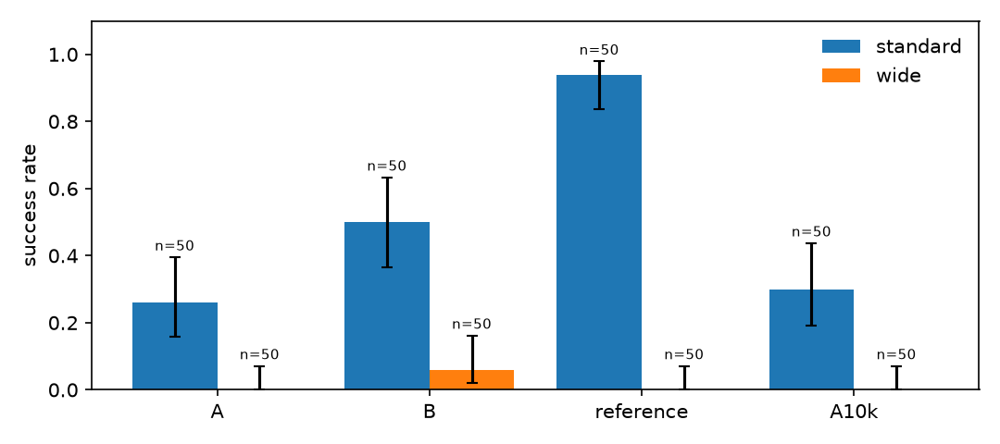
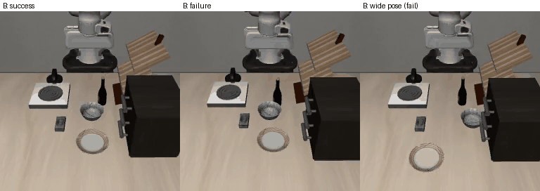

# ego2libero

Turning a handful of phone videos of my own hand into a LIBERO policy: recover the wrist
trajectory and grip from each video, multiply every demo into many simulated episodes at new
object poses, keep the ones that succeed, and fine-tune SmolVLA on them.

> Work in progress. Sections marked TODO are filled in as results come in.

## Overview

Task: LIBERO-Goal "put the bowl on the plate" (`libero_goal/8`), learned from 47 phone videos
of my own hand moving a tagged bowl onto a tagged plate. 38 of the demos replay successfully in
simulation; generation turns them into 2,711 successful episodes (71% of 3,800 attempts).

Fine-tuning SmolVLA on the 38 replayed demos alone (Run A) gives 26% on LIBERO's standard
initial states; adding the generated episodes (Run B) doubles that to 50%, and to 68–84% when
the policy replans every 5–10 steps instead of running each 50-step action chunk open loop.
Replanning also lifts Run B to 20% in the wide setting, where the objects start further away
than any generated episode put them.





*Run B (replanning every 10 steps) succeeding from six wide-setting starts, picked to be as far
apart as possible: the bowl and plate are moved 8–15 cm and turned 0.5–1.0 rad from LIBERO's
initial layout, so every approach is to a pose the policy never trained on. Shown at 4x speed.*

## Setup

```bash
git clone <repo> && cd ego2libero
make setup            # uv sync --all-groups + pre-commit hooks (Python 3.12, CUDA GPU)
make models           # MediaPipe hand_landmarker.task
make smoke            # lint, tests, CUDA check, LIBERO render check, pretrained baseline
```

DGX Spark / training-only machines: `uv sync --group train --group dev`.

## Pipeline

| Stage | Command | Output |
| --- | --- | --- |
| Capture | `scripts/make_markers.py`, `scripts/calibrate_phone.py` | printable markers, `data/calib/` |
| Perception | `e2l perception normalise`, `e2l perception run <demo>` | table-frame hand + objects |
| Segment | `e2l segment run <demo>` | object-centric hand segments |
| Retarget | `e2l retarget run <demo>` | Panda end-effector segments |
| Generate | `e2l generate run` | successful simulated episodes |
| Train | `e2l train export`, `e2l train finetune` | LeRobot dataset, SmolVLA checkpoint |
| Eval | `e2l eval rollout`, `e2l eval ablate`, `e2l eval report` | success rates, figures |

## Results

50 seeded episodes per cell, 95% Wilson intervals. All runs fine-tune `lerobot/smolvla_base`
for 20k steps at batch 32 and run each 50-step action chunk open loop, except where noted.

| Run | Training data | Standard | Wide |
| --- | --- | --- | --- |
| A | 38 replayed demos (7,750 frames, ~83 epochs) | 13/50 = 26% [16–40%] | 0/50 = 0% [0–7%] |
| A, 10k steps | same, ~41 epochs | 15/50 = 30% [19–44%] | 0/50 = 0% [0–7%] |
| B | + 2,711 generated episodes (571k frames, ~1.1 epochs) | 25/50 = 50% [37–63%] | 3/50 = 6% [2–16%] |
| B, replan every 25 steps | same checkpoint | 31/50 = 62% | |
| B, replan every 10 steps | same checkpoint | 40/50 = 80%; rerun 34/50 = 68% | **10/50 = 20%** [11–33%] |
| B, replan every 5 steps | same checkpoint | **42/50 = 84%** [71–92%] | |
| reference | `HuggingFaceVLA/smolvla_libero` (LIBERO teleop, replans every step) | 47/50 = 94% [84–98%] | 0/50 = 0% [0–7%] |

Run B's intermediate checkpoints score 32% (5k), 48% (10k) and 52% (15k) on standard, so it
had not plateaued. The two replan-every-10 runs use the same seeds; their 12-point gap is
the run-to-run noise of 50 episodes, so differences under ~15 points are not meaningful. The reference was trained on teleoperated demos of exactly this scene, so it
is an upper bound for the standard setting, not a baseline; it collapses in the wide setting.

Each policy is evaluated on LIBERO's standard initial states and on a **wide-pose** setting
where the bowl and plate are moved 8–15 cm and 0.5–1.0 rad beyond anything generation sampled
(`configs/eval.yaml: wide`). `e2l eval rollout --run <A|B|reference> --setting <standard|wide>`
writes `outputs/eval/<run>/<setting>/results.json`; `e2l eval report` turns them into
`docs/figures/results.md`, `success_rates.png` and `rollouts.gif`.

## Design choices

TODO

## What worked and what didn't

- **Generated episodes matter more than training longer.** Run A sees its 38 demos ~83 times
  and plateaus near 30%; Run B sees each episode about once and reaches 50% (68–84% replanning).
- **Replanning more often is the cheapest win.** `smolvla_base` executes all 50 predicted
  actions before looking again; a grasp that starts slightly off is never corrected.
  `configs/eval.yaml: n_action_steps` overrides this at evaluation time.
- **Replay success is mostly about the scene, not tracking.** The demos replayed at 17/47
  until the carry started from the sim bowl's actual pose, the set-down was centred on the
  plate (LIBERO counts "on" within 3 cm), the hand kept clear of the cabinet, wine bottle and
  rack, the round bowl kept its own yaw, and the rim grasp went 2 cm deeper: now 38/47.
- **Still failing:** two demos lose the plate tag in perception (008, 011); seven collide
  with the rack or table on the way to the grasp. No policy generalises to the wide setting:
  generation only moves objects ±8 cm / ±0.5 rad.
